# Awesome Enterprise Cloud Platform & Hosting ☁️🚀

<p align="center">
  
</p>

<p align="center">
  <a href="https://github.com/ishandutta2007/Awesome-Awesome-Awesome"></a><a href="https://discord.gg/jc4xtF58Ve"></a>
  <a href="https://github.com/ishandutta2007/Awesome-Enterprise-Cloud-Platform-Hosting/stargazers"></a>
  <a href="LICENSE"></a>
  <a href="https://github.com/ishandutta2007/Awesome-Enterprise-Cloud-Platform-Hosting/pulls"></a>
  <a href="https://github.com/ishandutta2007"></a>
</p>

> 🌐 **A curated list of top enterprise cloud platforms, IaaS providers, VPS hosting solutions, self-hosted private cloud infrastructure, and open-source cloud orchestration tools.**

This repository tracks industry-leading **SaaS & Hyperscale Cloud Platforms** alongside battle-tested **Open-Source GitHub Projects** for enterprise compute, virtualization, container orchestration, and cloud infrastructure hosting. Whether you need hyperscale public clouds, cost-effective developer VPS hosting, or full control with private on-premises IaaS, this guide provides comparative pricing, market valuation, and GitHub popularity metrics.

---

## 📑 Table of Contents

- [📊 Sector Overview & Market Dynamics](#-sector-overview--market-dynamics)
- [🏢 Enterprise Cloud & Hosting SaaS Platforms](#-enterprise-cloud--hosting-saas-platforms)
- [🛠️ Open-Source Cloud Infrastructure & Hosting Projects](#️-open-source-cloud-infrastructure--hosting-projects)
- [🏗️ Architecture & Platform Selection Guide](#️-architecture--platform-selection-guide)
- [⭐ Star History](#star-history)
- [💖 Support](#-support)
- [🤝 How to Contribute](#-how-to-contribute)
- [⚠️ Disclaimer](#️-disclaimer)

---

## 📊 Sector Overview & Market Dynamics

The global enterprise cloud computing and IaaS market is valued at approximately **$670+ billion in 2026** and projected to exceed **$1.2 trillion by 2030** (CAGR ~18–20%). The sector is **highly concentrated (oligopolistic / winner-take-most)** at the hyperscale foundation tier, with the "Big Three"—Amazon Web Services (~31%), Microsoft Azure (~24%), and Google Cloud Platform (~11%)—controlling two-thirds of worldwide infrastructure revenue. However, a vibrant, moderately fragmented secondary tier thrives around niche developer-centric VPS providers (DigitalOcean, Hetzner, OVHcloud) and sovereign/private open-source virtualization stacks (OpenStack, CloudStack, Proxmox VE, K3s) serving teams driven by data sovereignty, egress fee avoidance, and VMware cost migration.

---

## 🏢 Enterprise Cloud & Hosting SaaS Platforms

The table below lists leading commercial enterprise cloud and VPS hosting providers, ranked descending by **Market Valuation / Enterprise Scale**.

| Product | Enterprise Scale / Valuation | Description | Starting Pricing | Free Tier / Trial Limits |
|---------|-----------------------------|-------------|------------------|--------------------------|
| **[Microsoft Azure](https://azure.microsoft.com/)** | **~$3.1 Trillion** (Market Cap) | Enterprise hyperscale cloud featuring 60+ global datacenter regions, industry-leading hybrid-cloud solutions (Azure Arc), and seamless Microsoft enterprise stack integration. | B1s Linux VM from **$0.0116/hr** (~$8.47/month); App Service free tier available | **12-Month Free Tier**: 750 hrs B1s burstable VM, 5 GB Blob Storage; **$200 credit** for 30 days; 55+ services always free |
| **[AWS](https://aws.amazon.com/)** | **~$2.0 Trillion** (Amazon Market Cap) | The world's largest public cloud provider with over 200 fully-featured services, unmatched partner ecosystem, and deepest compliance certifications. | Lightsail Linux VPS from **$3.50/month** (512 MB RAM, 1 vCPU, 20 GB SSD); EC2 t4g.nano from **$0.0042/hr** | **12-Month Free Tier**: 750 hrs t2.micro/t3.micro per month, 5 GB S3 Standard Storage; **$200 credits** for eligible new signups |
| **[Google Cloud Platform](https://cloud.google.com/)** | **~$2.0 Trillion** (Alphabet Market Cap) | Cloud hyperscaler renowned for data analytics, Kubernetes engineering, premier AI/TPU infrastructure, and competitive sustained-use egress pricing. | Compute Engine e2-micro from **$0.0104/hr** (~$7.60/month); Cloud Storage from **$0.020/GB/month** | **Always Free Tier**: 1 non-preemptible e2-micro VM per month (US regions), 5 GB Cloud Storage, 1 GB BigQuery queries; **$300 credit** for 90 days |
| **[Oracle Cloud Infrastructure](https://www.oracle.com/cloud/)** | **~$420 Billion** (Market Cap) | Enterprise IaaS engineered for mission-critical enterprise workloads, high-performance bare metal compute, and Autonomous Database instances. | Compute Ampere A1 from **$0.01/OCPU/hr**; E4 standard compute from **$0.025/OCPU/hr** | **Always Free Tier**: 4 Arm Ampere A1 cores + 24 GB RAM, 2 AMD VMs (1/8 OCPU, 1 GB RAM each), 200 GB Block Storage, 2 Autonomous DBs (20 GB each); **$300 credit** for 30 days |
| **[Alibaba Cloud](https://www.alibabacloud.com/)** | **~$240 Billion** (Alibaba Group Market Cap) | Dominant cloud provider in China and Asia-Pacific, offering robust hybrid cloud, elastic compute (ECS), and cross-border enterprise solutions. | ECS t5-lc1m1.small from **$0.012/hr** (~$4.50/month); Object Storage Service (OSS) from **$0.018/GB/month** | **3-Month Free Trial**: 300 CNY (~$42) credit valid for 90 days (covers 2 vCPU / 2 GB RAM ECS); 50+ free-tier products for new users |
| **[DigitalOcean](https://www.digitalocean.com/)** | **~$3.6 Billion** (Market Cap) | Simple, developer-first cloud platform offering virtual private servers (Droplets), managed Kubernetes (DOKS), managed DBs, and predictable flat-rate egress. | Basic Droplet from **$4.00/month** (512 MB RAM, 1 vCPU, 10 GB SSD) or **$6.00/month** (1 GB RAM, 1 vCPU, 25 GB SSD) | **Free Trial**: **$200 credit** valid for 60 days for all new accounts; 3 static sites free on App Platform (no permanent free VPS) |
| **[OVHcloud](https://www.ovhcloud.com/)** | **~$1.8 Billion** (Market Cap) | Leading European sovereign cloud and dedicated server host offering transparent pricing, anti-DDoS mitigation, and GDPR-compliant European hosting. | Starter VPS from **$3.50/month** (1 vCPU, 2 GB RAM, 20 GB SSD); Public Cloud instances from **$0.0087/hr** | **Free Trial**: €200 cloud credit voucher for 30-day trials for verified enterprise accounts; no permanent free compute tier |
| **[Zoho Cloud](https://www.zoho.com/)** | **~$1.0 Billion** (Annual ARR / Private) | Bootstrapped enterprise SaaS ecosystem running on proprietary, vertically integrated datacenters emphasizing zero third-party trackers and strict privacy. | Zoho CRM starting at **$14/user/month**; Zoho Desk from **$14/agent/month**; Zoho One suite from **$37/employee/month** | **Always Free Tier**: Zoho CRM free up to 3 users; Zoho Desk free for 3 agents; Zoho Mail free up to 5 users (5 GB/user); 15-day unrestricted enterprise trials |
| **[Hetzner](https://www.hetzner.com/)** | **~$650 Million** (Annual Revenue / Private) | High-performance German cloud and dedicated hosting provider offering the industry's lowest price-to-performance compute with unmetered 20 TB traffic. | CX22 Cloud VPS from **€3.49/month** (~$3.79/month for 1 vCPU, 2 GB RAM, 40 GB NVMe, 20 TB traffic) | **Free Trial**: €20 trial credits upon account verification via support request; no permanent free compute instances |

---

## 🛠️ Open-Source Cloud Infrastructure & Hosting Projects

Curated self-hosted cloud platforms, virtualization management engines, lightweight IaaS stacks, and container PaaS tools. Sorted in descending order by **GitHub_Stars**.

| Project | GitHub_Stars | Category | Description |
|---------|:-----:|----------|-------------|
| **[Kubernetes](https://github.com/kubernetes/kubernetes)** | [](https://github.com/kubernetes/kubernetes/stargazers) | Container Orchestration | Production-grade container scheduling and workload management system. The de facto standard runtime foundation for modern cloud-native infrastructure across public, hybrid, and private clouds. |
| **[Coolify](https://github.com/coollabsio/coolify)** | [](https://github.com/coollabsio/coolify/stargazers) | Self-Hosted PaaS | An open-source, self-hosted alternative to Heroku, Vercel, and Netlify. Effortlessly deploys web apps, databases, and Docker workloads onto any Linux VPS with automatic SSL, Git push triggers, and zero lock-in. |
| **[Firecracker](https://github.com/firecracker-microvm/firecracker)** | [](https://github.com/firecracker-microvm/firecracker/stargazers) | MicroVM Hypervisor | Secure and ultra-fast microVM hypervisor written in Rust by AWS. Boots lightweight virtual machines in under 5 milliseconds with minimal memory overhead, powering AWS Lambda and Fargate at hyper-scale. |
| **[K3s](https://github.com/k3s-io/k3s)** | [](https://github.com/k3s-io/k3s/stargazers) | Lightweight Kubernetes | Highly available, certified Kubernetes distribution packaged as a single binary under 100 MB. Optimized for edge computing, IoT, ARM devices, and budget private cloud VPS hosting. |
| **[Dokku](https://github.com/dokku/dokku)** | [](https://github.com/dokku/dokku/stargazers) | Mini-Heroku PaaS | Docker-powered mini-Heroku PaaS and the smallest self-hosted platform imaginable. Push-to-deploy git repositories directly to your bare-metal server or cheap VPS with built-in Let's Encrypt SSL and plugin architecture. |
| **[Rancher](https://github.com/rancher/rancher)** | [](https://github.com/rancher/rancher/stargazers) | Multi-Cluster Management | Complete enterprise management platform for Kubernetes. Operates multi-cluster deployments across multi-cloud environments, bare-metal servers, and branch-office edge nodes with centralized RBAC and security. |
| **[OpenFaaS](https://github.com/openfaas/faas)** | [](https://github.com/openfaas/faas/stargazers) | Serverless Platform | Cloud-agnostic Serverless Functions framework for Kubernetes and Docker. Run microservices and event-driven functions on your own on-prem hardware or private cloud without AWS Lambda vendor lock-in. |
| **[CapRover](https://github.com/caprover/caprover)** | [](https://github.com/caprover/caprover/stargazers) | Web App & Database PaaS | Automated App/Database deployment dashboard and PaaS over Docker Swarm. Provides 1-click installations for over 100 applications (WordPress, Nextcloud, MongoDB, Postgres) with automatic Nginx configuration. |
| **[Ubicloud](https://github.com/ubicloud/ubicloud)** | [](https://github.com/ubicloud/ubicloud/stargazers) | Open IaaS Cloud | Open-source alternative to AWS running on commodity bare-metal providers like Hetzner and Leaseweb. Delivers elastic compute, block storage, load balancers, and managed Postgres at 3–10x lower cost than AWS. |
| **[Cloud Hypervisor](https://github.com/cloud-hypervisor/cloud-hypervisor)** | [](https://github.com/cloud-hypervisor/cloud-hypervisor/stargazers) | Rust VMM | Open-source Virtual Machine Monitor (VMM) running on top of KVM and MSHV, implemented in Rust with a primary design focus on high-density cloud-native virtualization workloads. |
| **[OpenStack](https://github.com/openstack/openstack)** | [](https://github.com/openstack/openstack/stargazers) | Hyperscale Private IaaS | The industry standard open-source enterprise cloud computing platform. Orchestrates massive pools of compute (Nova), storage (Cinder/Swift), and networking (Neutron) throughout telecommunication and enterprise datacenters. |
| **[Harvester](https://github.com/harvester/harvester)** | [](https://github.com/harvester/harvester/stargazers) | Hyperconverged HCI | Open-source hyperconverged infrastructure (HCI) built on Kubernetes, KubeVirt, and Longhorn. Modern open-source alternative to VMware vSphere and Nutanix for enterprise datacenter consolidation. |
| **[Apache CloudStack](https://github.com/apache/cloudstack)** | [](https://github.com/apache/cloudstack/stargazers) | Turnkey IaaS Platform | Mature, turnkey open-source infrastructure-as-a-service cloud orchestrator. Designed for enterprise private clouds and telecom service providers seeking simpler operational maintenance than OpenStack. |
| **[Cozystack](https://github.com/aenix-io/cozystack)** | [](https://github.com/aenix-io/cozystack/stargazers) | Turnkey PaaS / Cloud Engine | Free open-source PaaS and private cloud orchestrator based on Talos Linux and Kubernetes. Delivers a complete turnkey cloud ecosystem with automated storage, networking, and VM support at significant TCO savings. |
| **[OpenNebula](https://github.com/OpenNebula/one)** | [](https://github.com/OpenNebula/one/stargazers) | Enterprise Hybrid IaaS | Simple, minimalist enterprise cloud and edge computing management software. Orchestrates heterogeneous virtual machines (KVM), microVMs (Firecracker), and system containers on low-overhead footprints. |
| **[Proxmox VE](https://github.com/proxmox/pve-manager)** | [](https://github.com/proxmox/pve-manager/stargazers) | Virtualization Platform | Complete open-source server management platform for enterprise virtualization (KVM hypervisor, LXC containers, software-defined Ceph storage, and clustering). Premier migration target for VMware vSphere. |

---

## 🏗️ Architecture & Platform Selection Guide

```
+--------------------------------------------------------------------------------------------------+
|                                    WORKLOAD REQUIREMENTS                                         |
+--------------------------------------------------------------------------------------------------+
             |                                                                     |
             v                                                                     v
     [ Public Cloud SaaS ]                                                [ Self-Hosted / On-Prem ]
             |                                                                     |
    +--------+--------+                                                   +--------+--------+
    |                 |                                                   |                 |
    v                 v                                                   v                 v
[ Hyperscale IaaS ] [ Budget VPS / Sovereign ]                     [ Full IaaS Engine ] [ Virtualization / PaaS ]
AWS, Azure, GCP,    Hetzner (€3.49/mo)                             OpenStack,           Proxmox VE (VMware alt)
Oracle Cloud        OVHcloud ($3.50/mo)                            CloudStack,          Coolify / Dokku (App PaaS)
                    DigitalOcean ($4.00/mo)                        Ubicloud             K3s / Harvester (Kubernetes)
```

1. **For Hyperscale Public Workloads**: Choose **AWS**, **Microsoft Azure**, or **Google Cloud Platform** when you require global multi-region presence, complex compliance certifications, managed AI accelerators (TPUs/GPUs), and managed databases.
2. **For High-Performance Developer VPS & Low Egress**: Choose **Hetzner** for unbeatable European compute costs (€3.49/mo), or **DigitalOcean** for simple UX and predictable budgeting.
3. **For Free-Tier Lab Workloads**: Choose **Oracle Cloud Infrastructure**'s Always Free Tier (4 Arm Ampere cores + 24 GB RAM) for zero-cost experimental clusters.
4. **For VMware vSphere Replacement**: Choose **Proxmox VE** or **Harvester** to operate enterprise VM clusters and containerized storage without licensing extortion.
5. **For Private Cloud & Telecom IaaS**: Choose **OpenStack** for complex multi-tenant datacenters, or **Apache CloudStack** / **OpenNebula** for rapid operational setup.
6. **For Self-Hosted Heroku Alternatives**: Choose **Coolify** or **Dokku** to streamline web application deployments and databases on any bare-metal or cloud VPS instance.

---

## Star History

[](https://www.star-history.com/#ishandutta2007/Awesome-Enterprise-Cloud-Platform-Hosting&type=date&legend=top-left)

---

## 💖 Support

Thank you for exploring this curated guide to enterprise cloud platforms and hosting solutions! 🌟

If you find this repository valuable:
- ⭐ **Star this repository** to help others discover it!
- 🍴 **Fork it** and contribute your favorite platforms, benchmarking data, or corrections.
- 📢 **Share it** with fellow platform engineers, DevOps teams, and cloud architects on social media or forums.
- ☕ **Buy me a coffee / Sponsor**: If you'd like to support ongoing maintenance and new curated resources, you can sponsor the project via the [GitHub Sponsors Dashboard](https://github.com/sponsors/ishandutta2007).

Every bit of support is deeply appreciated! 🙌

---

## 🤝 How to Contribute

Contributions, project suggestions, and pricing updates are welcome!

1. 🍴 Fork this repository.
2. 🌿 Create a new branch: `git checkout -b feature/add-new-platform`.
3. 📝 Add your tool with official website link, accurate pricing / GitHub Stars_Badge, and clear description.
4. 🚀 Open a Pull Request with a short summary of the addition.

---

## ⚠️ Disclaimer

- This list is community-curated for informational and architectural comparison purposes.
- Cloud pricing, free tier terms, and trial allowances are subject to change by respective vendors. Verify current pricing and service level agreements (SLAs) directly on vendor portals before deployment.
- All trademarks and brand names belong to their respective owners.

---

<div align="center">
  <sub>Maintained with ❤️ for cloud architects, platform engineers, and sysadmins worldwide.</sub>
</div>
